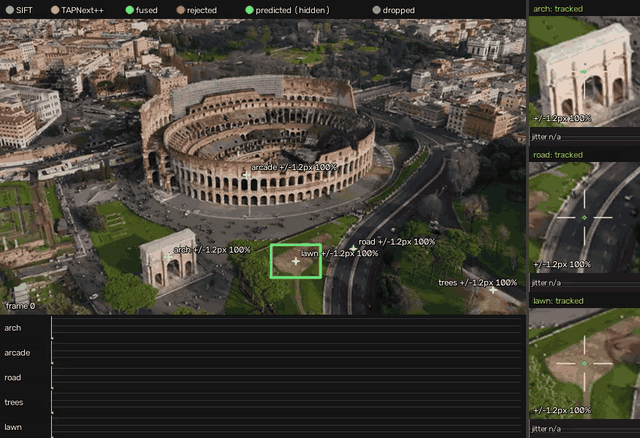
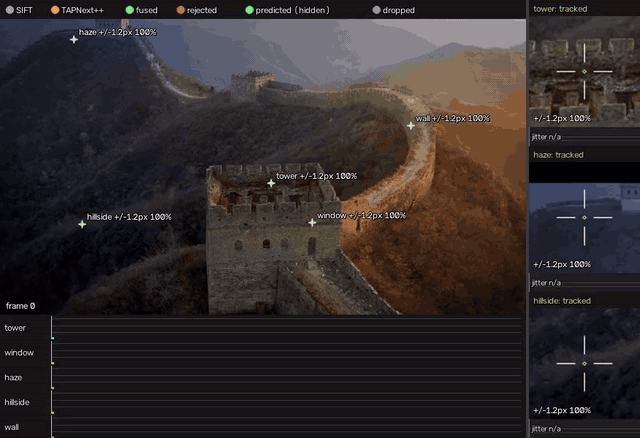
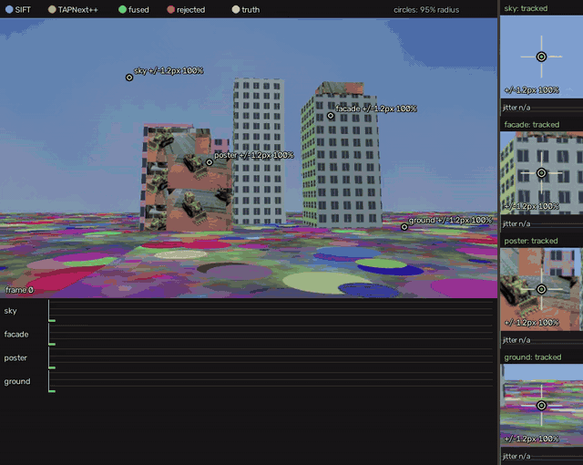

# SIFTAP: SIFT + TAPNext++ tracking with an honest uncertainty radius

Select a point or an area in a video; SIFTAP tracks it by fusing two very
different trackers and draws, every frame, a **95 % uncertainty circle**:
like a GPS fix, the circle is small when the tracker is sure and grows when
it is confused, and the true position lies inside it ~95 % of the time.

* **SIFT** (local keypoint matching back to the first frame): sub-pixel and
  drift-free when it finds the target, blind on weak texture, occasionally
  badly wrong.
* **TAPNext++** (DeepMind's learned point tracker, see `../coltap`): tracks
  anything, every frame, including sky and haze, but slowly drifts where the
  texture is weak.
* **Fusion**: a Kalman filter that treats TAPNext++ like an IMU (smooth,
  always there, drifts) and SIFT like GPS (absolute, intermittent, heavy
  tailed), with a gate and a mismatch model so a wrong SIFT match cannot pull
  the estimate.



*Colosseum drone orbit, every 3rd frame ([full-colour MP4](assets/siftap_colosseum.mp4)).
Arch, arcade and lawn: SIFT and TAPNext++ agree, ±1 px. Road (weak
texture): SIFT's own circle balloons to ±40 px and is sometimes rejected
(red), so the fused estimate follows TAPNext++. Trees: leaves the frame
and the label switches to "uncertain".*

Not structure from motion: one video, user-chosen targets, 2D tracks.

## Quick start

```bash
pip install -e ../coltap -e .
# --select needs OpenCV with windows (both wheels install cv2, so swap them):
pip uninstall -y opencv-python-headless && pip install opencv-python

# interactive: click = point, drag = area, u = undo, enter = start
siftap track --video clip.mp4 --select --output tracked.mp4

# scripted (frame-0 pixel coordinates; boxes are x,y,w,h)
siftap track --video clip.mp4 \
    --point 205,290 --name arch --box 330,275,60,40 --name lawn \
    --stride 3 --output tracked.mp4 --json tracks.json --tap_cache tap.pkl
```

| option | meaning |
|---|---|
| `--point x,y` / `--box x,y,w,h` / `--select` | targets on the first used frame (repeatable) |
| `--fusion` | `kalman` (default), `kalman_nodrift`, `kalman_nogate`, `kalman_ci`, `bayes`, `ivw`, `best`, `tap`, `sift` |
| `--no_sift` / `--no_tap` | single tracker |
| `--stride`, `--start`, `--max_frames`, `--max_size` | frame selection / resizing |
| `--output x.mp4\|x.gif`, `--output_width` | annotated video |
| `--json` | per-frame fused / SIFT / TAP positions, 95 % radii, gate decisions, P(mismatch) |
| `--tap_cache` | reuse the TAPNext++ pass (the slow part, ~1.5 s/frame on CPU) when video and targets match |

### Reading the video

| mark | meaning |
|---|---|
| dashed blue circle | SIFT measurement and its 95 % radius (includes the chance that the match is wrong) |
| dashed orange circle | TAPNext++ measurement and its 95 % radius (per-frame part) |
| green disc + cross | fused estimate and its 95 % radius, with the number in px; green line: trail |
| red dot with X | measurement rejected by the gate (it contradicts the others) |
| thin dashed green circle | target out of view or very uncertain |
| timelines | per target, 95 % radius over time on a log scale (0.3 to 150 px) |
| white ring / dots (synthetic demo) | true position / true error of the fused estimate |



*Great Wall ([MP4](assets/siftap_great_wall.mp4)). Tower and window: ±1.5 px.
Haze (no texture, no SIFT): the circle grows slowly to ±15 px as
TAPNext++'s possible drift accumulates. Hillside: hidden behind the tower
for ~70 frames, so the circle grows to hundreds of px; TAPNext++
re-detects it and the circle snaps back to ±8 px, like GPS after a tunnel.
Wall: leaves the frame.*

On the synthetic held-out sequence the truth is drawn, so you can check the
circles: the white ring should stay inside the green circle, and the white
dotted error trace below the green radius line.



*Held-out synthetic sequence ([MP4](assets/siftap_synthetic_test.mp4)), one
target per surface. The truth stays inside the circles. Facade: SIFT
sometimes matches the neighbouring window; the gate rejects it and the
circle widens while the two candidates disagree.*

## Research: what each tracker is good at, measured

All numbers come from `benchmark/evaluate.py`: a ray-traced street scene
with exact ground truth and four surfaces (low-texture sky dome, repetitive
window facades, photo posters, textured ground), occlusions, 1x/2x speed and
motion blur; 40 targets per sequence. Uncertainties are calibrated on
`calib` + `calib2` only; `test` and `fast` (2x speed, blur) are held out.

| | SIFT (matches to frame 0) | TAPNext++ |
|---|---|---|
| available | posters 87 %, facades 19 %, ground 3 %, sky 0 % of frames | ~every frame until occluded |
| accuracy when right | 0.24 px median (posters) | 0.4-0.7 px on texture, 3-5 px on sky |
| failure mode | gross mismatch (11 %, ~37 px rms): few inliers, repetitive windows, periodic ground | slow drift on weak texture (sky 1-2 px early, 6-8 px after 60 frames) |
| drift | none (always matched back to the reference) | yes: lag-5 error autocorrelation 0.93-0.98 on sky and ground |
| its own confidence | inlier count, inlier ratio, LS covariance | heatmap spread (softmax over 256 bins), visibility |
| is that confidence honest? | no: the LS covariance covers 66 %; fixed by a mismatch model + texture term (97 %) | per-frame only, blind to drift (held-out sky: 64 % coverage); fixed by a texture-driven drift model |
| cost | cheap, CPU | heavy network (~1.5 s/frame on CPU for 5 targets) |

Your intuition was right in its main point. SIFT wins on obvious features,
and TAPNext++ is the only one that follows sky and haze at all. Two details
were not obvious, though:

1. **TAPNext++'s own confidence does not see its main error.** The heatmap
   says how sharp the match is *in this frame*. On weak texture the error
   is an offset that builds up over time. The heatmap stays fairly peaked
   while the track walks away (we checked the ground truth first: the dome
   is at finite distance and TAPNext++ follows it to 4-8 px, not a
   sky-at-infinity motion). The image itself predicts this drift much better.
   The Lucas-Kanade / Shi-Tomasi texture information around the point is
   1/sqrt(smallest eigenvalue of the structure tensor), the Cramer-Rao
   bound for aligning that patch. It reaches a log-correlation of 0.86 with
   TAPNext++'s late error, against 0.74 for the heatmap. Sky has 25x less
   of it than a poster.
2. **SIFT's errors are not Gaussian.** When SIFT is right it is ~0.3 px.
   When it is wrong it is wrong by tens of pixels. Any single Gaussian is
   then either far too wide (10 px radius on posters with 0.2 px errors)
   or far too narrow. SIFTAP keeps both parts: a core covariance plus a
   probability that the match is wrong. A logistic model on log(inliers)
   and the inlier ratio predicts it: 0 % mismatches below p = 0.01, 69 %
   above p = 0.5. One failure SIFT cannot see in itself: a consistent
   match to the next copy of a periodic texture (7-10 inliers, ratio 1.0,
   10-15 px off). Only an independent tracker can catch that.
3. **The same image property predicts both trackers' errors.** Given the
   texture term, the calibration gives SIFT's least-squares covariance
   almost no weight (scale 0.1). SIFT's localization error is then
   0.5 px plus a texture term. Keypoints on weak texture (ground) are off
   by 1-3 px while the fit residuals claim 0.4 px. So local texture
   information is a confidence cue that is independent of both trackers,
   and it is cheap to compute.

## How they are combined

Your guesses (Bayesian, Kalman) are both in here. A Kalman filter *is*
recursive Bayesian estimation, and the pieces below are what made it work.

**Measurement models** (`siftap/geometry.py`, `sift.py`, `tap.py`)

* SIFT: position from a RANSAC + weighted-LS similarity fit of the keypoints
  around the target. Covariance = (0.1 · LS)² + 0.5² + (35 · texture_sigma)²
  (+ keyframe anchor uncertainty). P(mismatch) comes from the logistic
  model, and a mismatch is ~37 px rms.
* TAPNext++: position of the target point, per-frame covariance from the
  calibrated heatmap spread. It measures *position + drift*. The drift is a
  random walk with per-frame std κ · texture_sigma.

**Filter** (`siftap/fusion.py`, default `kalman`). The state is
[x, y, vx, vy, drift_x, drift_y], with constant velocity. Per frame:

1. Predict. The prior also centres and sizes SIFT's search window.
2. Order the measurements, most reliable first.
3. Gate: reject a measurement whose Mahalanobis distance to the prediction
   exceeds the 99.7 % χ² quantile. A rejection widens the covariance by part
   of the disagreement, so a real conflict shows up as a larger circle.
   After two frames with everything rejected, re-acquire.
4. Mixture update for SIFT. The posterior probability that the match is
   right, w, combines its prior P(mismatch) with how well it agrees with
   the prediction. The update is the inlier/outlier mixture collapsed to one
   Gaussian (a one-measurement PDA filter): P = w P_upd + (1-w) P_prior +
   w(1-w) d dᵀ.
5. SIFT measures position, TAPNext++ measures position + drift. Whenever
   SIFT is available the drift becomes observable and is subtracted from
   TAPNext++, also in later frames without SIFT. Without SIFT the drift
   variance grows, and so does the circle.

**Why not the simpler options** (all are implemented and benchmarked below):

* *Naive Bayes / product of Gaussians* (`ivw`) believes SIFT's tiny
  covariance even when the match is wrong. It is less accurate than
  TAPNext++ alone, and its circles are badly overconfident.
* *Best-of* (`best`) and *robust static Bayes* (`bayes`) have no memory. They
  cannot tell which of two disagreeing trackers is wrong, and they cannot
  estimate drift.
* *Kalman without the gate* (`kalman_nogate`) is pulled off by mismatches
  (3x the failure rate).
* *Covariance intersection* (`kalman_ci`) protects against unknown
  correlation between the two trackers. Here their errors come from
  different mechanisms, so it mostly throws information away.
* *Particle filter / Gaussian sum*: the right tool when several hypotheses
  must be kept (e.g. "window 3 or window 4" on a facade). It is not
  implemented; that is the natural next step.

**Calibration criterion.** A radius is only useful if it is honest
everywhere. Scale, floor and drift rate are fitted so that the drawn 95 %
circle covers 95 % of the errors in every cell of
(uncertainty quintile × early/middle/late), not just on average.

## Results

**Measurement calibration** (truth inside the drawn 95 % circle / median radius px):

| model | sequence | all | sky | facade | poster | ground |
|---|---|---|---|---|---|---|
| SIFT, LS covariance only | calib | 66 % / 0.4 | - | 44 % / 0.6 | 73 % / 0.4 | 8 % / 0.7 |
| SIFT, calibrated + mismatch mixture | calib | 97 % / 1.3 | - | 95 % / 69.1 | 99 % / 1.3 | 58 % / 3.1 |
| TAPNext++ raw heatmap | calib | 100 % / 4.4 | 99 % / 10.5 | 100 % / 4.3 | 100 % / 3.3 | 100 % / 5.0 |
| TAPNext++ heatmap, scaled | calib | 99 % / 3.9 | 96 % / 9.3 | 100 % / 3.8 | 100 % / 2.9 | 99 % / 4.4 |
| TAPNext++ heatmap, scaled | test | 92 % / 4.4 | 66 % / 5.8 | 100 % / 4.3 | 100 % / 3.1 | 100 % / 5.5 |
| TAPNext++ heatmap, scaled | fast | 95 % / 3.9 | 79 % / 5.7 | 100 % / 3.8 | 100 % / 2.5 | 100 % / 5.4 |
| TAPNext++ heatmap + texture drift | calib | 96 % / 1.3 | 100 % / 11.2 | 93 % / 1.1 | 96 % / 0.9 | 96 % / 2.9 |
| TAPNext++ heatmap + texture drift | test | 91 % / 1.8 | 100 % / 12.7 | 91 % / 1.1 | 83 % / 1.0 | 89 % / 3.1 |
| TAPNext++ heatmap + texture drift | fast | 98 % / 1.3 | 96 % / 9.8 | 98 % / 1.1 | 99 % / 0.9 | 97 % / 3.1 |

**Fusion on the held-out `test` sequence** (all 40 targets):

| fusion | median err px | fail % (> 8 px) | truth inside circle | median radius px |
|---|---|---|---|---|
| TAPNext++ alone, heatmap sigma only (no drift term) | 0.97 | 5.5 | 50 % | 1.08 |
| SIFT alone (no TAP to guide the search) | 18.33 | 61.5 | 29 % | 2.54 |
| best-of (smaller radius wins) | 0.97 | 5.5 | 50 % | 1.08 |
| naive Bayes (product of Gaussians) | 1.50 | 9.3 | 38 % | 0.97 |
| robust Bayes (gate + mixture, no motion) | 0.93 | 5.5 | 50 % | 1.10 |
| Kalman, gate + mixture, white TAP noise | 0.93 | 5.5 | 49 % | 1.05 |
| **Kalman, gate + mixture + TAP drift (default)** | 0.95 | 5.8 | 89 % | 2.31 |
| Kalman without gate | 2.43 | 18.0 | 67 % | 1.22 |
| Kalman, covariance intersection | 0.99 | 5.9 | 48 % | 1.05 |
| Kalman + drift, TAPNext++ only | 0.97 | 5.8 | 90 % | 1.67 |

Per surface on `test` (median error px / truth inside circle / median radius px):

| fusion | sky | facade | poster | ground |
|---|---|---|---|---|
| TAPNext++ alone, heatmap sigma only (no drift term) | 4.77 / 3 % / 1.3 | 0.58 / 89 % / 1.0 | 0.51 / 76 % / 0.8 | 1.59 / 30 % / 1.3 |
| SIFT alone (no TAP to guide the search) | 12.45 / 0 % / inf | 49.44 / 39 % / 67.5 | 0.41 / 72 % / 2.2 | 62.41 / 1 % / 49.9 |
| naive Bayes (product of Gaussians) | 4.77 / 3 % / 1.3 | 1.23 / 45 % / 0.9 | 0.48 / 74 % / 0.7 | 1.59 / 29 % / 1.3 |
| Kalman, gate + mixture, white TAP noise | 4.75 / 2 % / 1.3 | 0.55 / 90 % / 1.3 | 0.47 / 76 % / 0.7 | 1.62 / 27 % / 1.2 |
| **Kalman, gate + mixture + TAP drift (default)** | 4.68 / 99 % / 12.4 | 0.51 / 93 % / 1.3 | 0.35 / 84 % / 0.8 | 1.76 / 79 % / 2.7 |

**Fusion on the held-out `fast` sequence** (all 40 targets):

| fusion | median err px | fail % (> 8 px) | truth inside circle | median radius px |
|---|---|---|---|---|
| TAPNext++ alone, heatmap sigma only (no drift term) | 0.55 | 4.0 | 69 % | 0.97 |
| SIFT alone (no TAP to guide the search) | 15.22 | 58.1 | 26 % | 2.27 |
| best-of (smaller radius wins) | 0.55 | 4.0 | 69 % | 0.97 |
| naive Bayes (product of Gaussians) | 0.67 | 9.2 | 57 % | 0.87 |
| robust Bayes (gate + mixture, no motion) | 0.54 | 4.0 | 68 % | 0.98 |
| Kalman, gate + mixture, white TAP noise | 0.55 | 3.9 | 66 % | 0.92 |
| **Kalman, gate + mixture + TAP drift (default)** | 0.54 | 3.7 | 92 % | 1.34 |
| Kalman without gate | 1.20 | 15.9 | 71 % | 1.06 |
| Kalman, covariance intersection | 0.55 | 3.9 | 68 % | 0.95 |
| Kalman + drift, TAPNext++ only | 0.55 | 3.7 | 97 % | 1.22 |

Per surface on `fast` (median error px / truth inside circle / median radius px):

| fusion | sky | facade | poster | ground |
|---|---|---|---|---|
| TAPNext++ alone, heatmap sigma only (no drift term) | 2.75 / 27 % / 1.3 | 0.33 / 97 % / 0.9 | 0.40 / 90 % / 0.7 | 1.10 / 53 % / 1.3 |
| SIFT alone (no TAP to guide the search) | 7.83 / 0 % / inf | 47.75 / 27 % / 43.2 | 0.94 / 78 % / 2.2 | 103.45 / 0 % / 60.0 |
| naive Bayes (product of Gaussians) | 2.72 / 28 % / 1.3 | 0.43 / 65 % / 0.8 | 0.38 / 83 % / 0.7 | 1.15 / 52 % / 1.3 |
| Kalman, gate + mixture, white TAP noise | 2.76 / 27 % / 1.2 | 0.30 / 97 % / 0.9 | 0.40 / 82 % / 0.6 | 1.12 / 51 % / 1.2 |
| **Kalman, gate + mixture + TAP drift (default)** | 2.71 / 96 % / 9.4 | 0.29 / 99 % / 0.9 | 0.38 / 82 % / 0.7 | 1.13 / 91 % / 2.9 |

### Verdict

* **Accuracy:** on this benchmark the fusion is only slightly better than
  TAPNext++ alone overall (median 0.95 vs 0.97 px on `test`, 0.54 vs 0.55 px
  on `fast`, same failure rate). SIFT's gain is local and real where it can
  see the target: posters 0.35 vs 0.51 px (-31 %), facades 0.51 vs 0.58 px.
  SIFT alone is not a usable tracker here (it loses weak-texture targets).
* **Honest uncertainty is the big win:** the truth is inside the drawn
  circle 89 % / 92 % of the time (held-out `test` / `fast`) against
  38-69 % for every alternative; on the sky 99 % / 96 % against 3 % / 27 %.
  Most of that comes from the texture-driven drift model, which also works
  for TAPNext++ alone (`--no_sift`: 90 % / 97 %).
* **Cost of SIFT:** on repetitive facades SIFT sometimes matches the
  neighbouring window. The gate rejects it, but the conflict widens the
  circle for a frame (the flicker in the facade timeline of the synthetic
  demo), so the fused median radius (2.3 px) is larger than TAPNext++-only
  with drift (1.7 px). That is the right signal ("two candidates 15 px
  apart") but a multi-hypothesis filter would express it better.
* **Still overconfident:** posters 82-84 % (target 95 %) and ground 79 % on
  `test`. The calibration sequences reach 91-92 % overall, below the 95 %
  target.

The `tap` and `kalman_nodrift` rows use the drift model's heatmap scale
without its drift term. A white-noise-only recalibration of the heatmap
reaches 92 % / 95 % coverage at the measurement level, but with circles ~3x
larger (first table).

## Limitations

* Calibrated on synthetic sequences. The texture term depends on image
  contrast and noise (compression), so on real footage treat the radius as
  well-ordered rather than exactly 95 %. A few hand-labelled real points
  would recalibrate κ.
* Repetitive structure is handled by gating, not by keeping several
  hypotheses (see particle filter above).
* Static scenes. Moving objects are tracked by TAPNext++, but SIFT's
  frame-0 reference assumes the target's appearance stays similar. An
  adaptive keyframe is added when SIFT degrades.
* Area targets use a similarity transform (no perspective).
* TAPNext++ on CPU is slow. Use `--tap_cache` to re-run the fusion or the
  rendering without the network.

## Reproduce

```bash
python benchmark/evaluate.py --work_path WORK --poster_path IMAGES --stage all \
    --output_path assets
# stages: render | tap | calibrate | compare | demo | tables
pytest tests
```

Demo clips: `Colosseum.mp4` and `great_wall.mp4` from the VGGT examples
(640x360):

```bash
siftap track --video Colosseum.mp4 --stride 3 --max_frames 180 \
    --point 205,290 --name arch --point 300,190 --name arcade \
    --point 430,280 --name road --point 600,330 --name trees \
    --box 330,275,60,40 --name lawn --output_width 960 \
    --output colosseum.mp4 --tap_cache colosseum_tap.pkl
siftap track --video great_wall.mp4 --stride 2 --max_frames 144 \
    --point 330,200 --name tower --point 380,248 --name window \
    --point 90,25 --name haze --point 100,250 --name hillside \
    --point 500,130 --name wall --output_width 960 \
    --output great_wall.mp4 --tap_cache great_wall_tap.pkl
``` See
`../development_note/modules/siftap/timeline.md` for the full research log.
